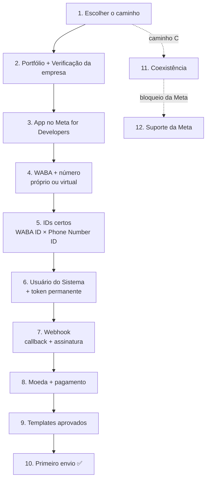

# WhatsApp Meta Onboarding — MCP Server

     

`#mcp` `#whatsapp-cloud-api` `#numero-virtual` `#coexistencia` `#meta-graph-api` `#onboarding`

## Apoie o projeto

<p align="center">
  <br>
  <strong>Me pague um Café</strong><br>
  <sub>QR Code <strong>Pix</strong>: abra o aplicativo do seu banco, escolha Pix &gt; Ler QR Code e aponte a câmera.</sub>
</p>

A imagem acima é um **QR Code Pix**. Se este guia poupou seu tempo, considere apoiar com um café. A contribuição ajuda a manter o
projeto atualizado: acompanhar as mudanças da Meta na Cloud API e na Coexistência, registrar novas armadilhas e erros e incluir
novas verificações.

Reclamações, ideias, falhas encontradas ou sugestões:
[contato@lumenaxis.dev.br](mailto:contato@lumenaxis.dev.br)

---

Servidor **MCP** (Model Context Protocol) que **ensina o caminho completo** para colocar um número de WhatsApp — inclusive um **número virtual criado direto na Meta** — enviando pela **API oficial (Cloud API)**, cobre a **Coexistência** (app WhatsApp Business + API no mesmo número) e **diagnostica cada etapa** na Graph API.

O conteúdo nasceu de implantações reais (jul–out/2026), com todos os erros e becos sem saída do caminho. Cada armadilha vem marcada:

- `vivido` — aconteceu na prática, com a causa real e o que resolveu;
- `doc-meta` — vem da documentação pública da Meta; confirme na tela, porque a Meta muda.

---

## Sumário

- [O caminho](#o-caminho)
- [Ferramentas](#ferramentas)
- [Instalação](#instalação)
- [Configuração](#configuração)
- [Como usar](#como-usar)
- [Tags](#tags)
- [Segurança](#segurança)
- [Estrutura do repositório](#estrutura-do-repositório)
- [Contribuir](#contribuir)
- [Créditos](#créditos)
- [Licença](#licença)

---

## O caminho



| # | Fase | Tags | Em uma frase |
|---|---|---|---|
| 1 | [Escolher o caminho](docs/fases/01-escolher-caminho.md) | `#cloud-api` `#numero-virtual` `#coexistencia` | Número novo/virtual, número existente ou coexistência — portas com pré-condições opostas |
| 2 | [Portfólio e verificação](docs/fases/02-empresa-portfolio.md) | `#portfolio` `#irreversivel` | Sem empresa verificada não há registro de número real |
| 3 | [App da Meta](docs/fases/03-app-meta.md) | `#app` `#seguranca` | Um app por sistema: o webhook é por app |
| 4 | [WABA e número](docs/fases/04-conta-e-numero.md) | `#waba` `#numero-virtual` `#cloud-api` | Número virtual exige nome de exibição aprovado (131037) |
| 5 | [IDs certos](docs/fases/05-ids.md) | `#ids` `#waba` | O ID do Gerenciador **não** é o WABA ID da API |
| 6 | [Usuário do Sistema e token](docs/fases/06-usuario-sistema-token.md) | `#token` `#seguranca` | Token que nunca expira, com acesso mínimo |
| 7 | [Webhook](docs/fases/07-webhook.md) | `#webhook` `#seguranca` | "A mensagem não chegou": callback vazio e WABA não inscrita |
| 8 | [Faturamento](docs/fases/08-faturamento.md) | `#faturamento` `#irreversivel` | Moeda é irreversível; sem cartão só a janela de 24h |
| 9 | [Templates](docs/fases/09-templates.md) | `#templates` | Só REJECTED edita; não migram entre WABAs |
| 10 | [Primeiro envio](docs/fases/10-primeiro-envio.md) | `#envio` | Aceito pela API ≠ entregue: leia o webhook de status |
| 11 | [Coexistência](docs/fases/11-coexistencia.md) | `#coexistencia` `#irreversivel` | Parâmetros v4, `smb_app_data` uma vez em 24h, o que se perde |
| 12 | [Suporte da Meta](docs/fases/12-suporte-meta.md) | `#suporte` | Onde há humano e onde é parede de IA |

Referência completa em [`docs/`](docs/README.md): [ferramentas](docs/ferramentas.md) · [erros](docs/erros.md) · [glossário](docs/glossario.md) · [tags](docs/tags.md).

---

## Ferramentas

### Ensino (offline, sem token)

| Ferramenta | Para quê |
|---|---|
| `wa_guide_overview` | As 12 fases, quem faz o quê, o que o agente nunca faz |
| `wa_guide_get_phase` | Uma fase: passos **VOCÊ / AUTOMÁTICO / JUNTOS**, checklist, armadilhas |
| `wa_guide_search` | Busca por texto e/ou tag em passos, armadilhas e erros |
| `wa_explain_error` | Código ou texto de erro → significado, o que fazer, fase |
| `wa_glossary` | WABA × conta de mensagens × Phone Number ID etc. |

### Diagnóstico (Graph API, somente leitura)

| Ferramenta | Para quê |
|---|---|
| `wa_diagnose` | Checklist completo ✅/⚠️/❌ e a **próxima fase** a corrigir |
| `wa_check_token` | Tipo (SYSTEM_USER?), validade, permissões, WABAs visíveis — nunca mostra o token |
| `wa_discover_ids` | WABA IDs e Phone Number IDs corretos a partir do token |
| `wa_check_waba` | Análise da conta, verificação da empresa, moeda |
| `wa_list_phone_numbers` | Status, nome de exibição, plataforma, qualidade, tier |
| `wa_check_webhook` | Apps inscritos na WABA |
| `wa_check_app_webhook` | Callback e campos assinados do app (precisa de `META_APP_ID`/`META_APP_SECRET`) |
| `wa_list_templates` | Templates e status, paginado |
| `wa_check_coexistence` | Prova oficial: `is_on_biz_app` + `platform_type` |

### Ações (alteram algo — exigem `confirm=true`)

| Ferramenta | O que faz |
|---|---|
| `wa_subscribe_webhooks` | Inscreve o app na WABA (opcional: `override_callback_uri` por WABA) |
| `wa_send_template_test` | Envia um template **de verdade** (pode ser cobrado) |

Também expõe **recursos** (`wa-guide://visao-geral`, `wa-guide://glossario`, `wa-guide://tags`, `wa-guide://erros`, `wa-guide://fase/{id}`) e o **prompt** `wa_conduzir_onboarding`, que conduz a conversa fase a fase.

---

## Instalação

Requer Node.js 20.3+.

```bash
git clone https://github.com/lucianumm/whatsApp-meta-onboarding-mcp-server.git
cd whatsApp-meta-onboarding-mcp-server
npm install
npm run check   # build + smoke test + docs
```

> No npm 11+, se o `tsx` reclamar do `esbuild`, rode `npm approve-scripts esbuild`.

---

## Configuração

Todas as variáveis são opcionais: sem nenhuma, as ferramentas de ensino funcionam. Veja [`.env.example`](.env.example).

| Variável | Uso |
|---|---|
| `META_ACCESS_TOKEN` | Token de **Usuário do Sistema** (nunca expira). Necessário para diagnóstico e ações. |
| `META_WABA_ID` | WABA ID padrão (o `wa_discover_ids` descobre) |
| `META_PHONE_NUMBER_ID` | Phone Number ID padrão |
| `META_GRAPH_VERSION` | Padrão `v25.0` |
| `META_APP_ID` / `META_APP_SECRET` | Só para `wa_check_app_webhook` (token de app) |

### Claude Code

```bash
claude mcp add whatsapp-meta --scope user -- node /caminho/para/whatsApp-meta-onboarding-mcp-server/dist/index.js
```

Para as ferramentas de rede, acrescente `--env META_ACCESS_TOKEN=...` **você mesmo** no terminal (o agente não digita segredos).

### Claude Desktop (`claude_desktop_config.json`)

```json
{
  "mcpServers": {
    "whatsapp-meta": {
      "command": "node",
      "args": ["/caminho/para/whatsApp-meta-onboarding-mcp-server/dist/index.js"],
      "env": {
        "META_ACCESS_TOKEN": "cole-aqui",
        "META_WABA_ID": "",
        "META_PHONE_NUMBER_ID": ""
      }
    }
  }
}
```

---

## Como usar

Peça ao Claude em linguagem natural; ele escolhe as ferramentas:

- *"Quero conectar um número virtual para disparos. Por onde começo?"* → `wa_guide_overview` → `wa_guide_get_phase`
- *"Em que ponto estou?"* → `wa_diagnose`
- *"Deu 131037 no envio."* → `wa_explain_error`
- *"Qual é o meu WABA ID de verdade?"* → `wa_discover_ids`
- *"Mandei mensagem e não chegou no sistema."* → `wa_check_webhook` + `wa_check_app_webhook`
- *"A coexistência ativou?"* → `wa_check_coexistence`
- *"Tudo sobre coisas irreversíveis."* → `wa_guide_search` com `tag: irreversivel`

Ou use o prompt **`wa_conduzir_onboarding`** para um passo a passo guiado.

---

## Tags

Vocabulário fechado, definido em [`src/knowledge/types.ts`](src/knowledge/types.ts). Cada fase e cada erro tem as suas; o índice completo está em [`docs/tags.md`](docs/tags.md).

| Tag | Assunto |
|---|---|
| `#cloud-api` | API oficial hospedada pela Meta (registro padrão) |
| `#numero-virtual` | Número fornecido pelo próprio WhatsApp |
| `#coexistencia` | App WhatsApp Business + Cloud API no mesmo número |
| `#portfolio` | Portfólio empresarial e verificação |
| `#app` | App no Meta for Developers |
| `#waba` | Conta do WhatsApp e número |
| `#ids` | IDs que confundem |
| `#token` | Usuário do Sistema, token, permissões |
| `#webhook` | Recebimento de mensagens e status |
| `#faturamento` | Moeda, pagamento, cobrança |
| `#templates` | Modelos de mensagem |
| `#envio` | Envio, entrega e erros |
| `#suporte` | Onde pedir ajuda à Meta |
| `#seguranca` | Segredos, permissões mínimas |
| `#irreversivel` | Ação que não dá para desfazer |

---

## Segurança

- O token **nunca** aparece em respostas nem em mensagens de erro (é removido antes de sair).
- Só duas ferramentas alteram algo, e ambas exigem `confirm=true`.
- O agente **não** digita tokens/App Secret/senhas, **não** cadastra cartão, **não** exclui portfólio/WABA/número e **não** aceita termos sem confirmação.
- Detalhes em [SECURITY.md](SECURITY.md).

---

## Estrutura do repositório

```
├── src/
│   ├── index.ts              # servidor: ferramentas, recursos, prompt (stdio)
│   ├── graph.ts              # cliente da Graph API, erros com dica, remoção de segredos
│   ├── api.ts                # chamadas tipadas (token, WABA, números, templates, webhook)
│   ├── knowledge/            # ← o conhecimento: edite aqui
│   │   ├── types.ts          #   tipos + vocabulário de tags
│   │   ├── phases.ts         #   as 12 fases (passos, checagens, armadilhas)
│   │   ├── errors.ts         #   catálogo de erros + glossário
│   │   └── render.ts         #   Markdown, busca, índice de tags
│   └── tools/                # ferramentas wa_* por domínio
├── scripts/
│   ├── smoke.ts              # teste ponta a ponta como cliente MCP
│   └── generate-docs.ts      # gera docs/ a partir de src/knowledge/
├── docs/                     # gerado — não edite à mão
├── evals/evaluation.xml      # perguntas de avaliação do MCP
├── imagens/                  # QR Code Pix "Me pague um Café"
└── .github/                  # CI, templates de issue e PR
```

---

## Contribuir

Descobriu uma armadilha nova? Veja [CONTRIBUTING.md](CONTRIBUTING.md) — em resumo: acrescente em `src/knowledge/`, rode `npm run check` e faça commit de `docs/` junto. O histórico de versões está no [CHANGELOG.md](CHANGELOG.md).

---

## Créditos

Criado e mantido por **Lucianum** —
[Instagram @lucianum](https://instagram.com/lucianum) ·
[GitHub @lucianumm](https://github.com/lucianumm)

## Aviso

Projeto independente, sem vínculo com a Meta Platforms. WhatsApp, Meta e Facebook são marcas de seus respectivos donos. As telas e
regras da Meta mudam com frequência: confirme no painel antes de qualquer ação irreversível.

## Licença

Copyright (c) 2026 Lucianum.

Distribuído sob a [Licença MIT](LICENSE): você pode usar, copiar, modificar e redistribuir livremente, inclusive para fins
comerciais, desde que mantenha o aviso de copyright e a licença.
